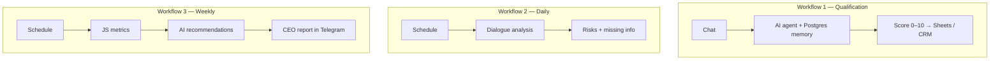

# GrowthBot AI — Lead Qualification & Sales Reporting

> Three n8n workflows: AI lead qualification agent (0–10 score), daily dialogue analysis and a weekly CEO report in Telegram.

 

## Problem

- Lead qualification was inconsistent between managers.
- Management had no regular, data-based view of the pipeline.

## Solution

Built in **n8n**:

1. AI qualification agent with PostgreSQL chat memory: needs, budget, timeline, 0–10 score saved to Google Sheets / Zoho CRM
2. Daily dialogue analysis: risks and missing information
3. Weekly CEO report: metrics calculated in JavaScript plus AI analysis and recommendations sent to Telegram

## Architecture

## Tech stack

- n8n
- LLM
- PostgreSQL (agent memory)
- Google Sheets
- Zoho CRM
- JavaScript
- Telegram Bot API

## Results

- Standardized lead scoring
- Automated management reporting without manual Excel work

## Workflow files

Workflow JSON exports are in [`workflows/`](workflows). Credentials, IDs and personal data are removed: import into n8n and connect your own credentials.

## Case study & demo

Full case study with screenshots and a demo video: **[Notion portfolio](https://tree-plantain-8cf.notion.site)**

## Author

**Kyrylo Kirillov** — AI Automation Engineer (n8n, Make, LLM agents)  
[Upwork](https://www.upwork.com/freelancers/~019bcb1ca9cd59b3ad) · [LinkedIn](https://www.linkedin.com/in/kirillov-kirill) · [Portfolio](https://tree-plantain-8cf.notion.site) · Telegram [@Veter218](https://t.me/Veter218)
